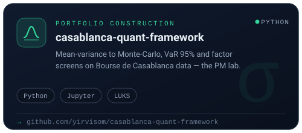
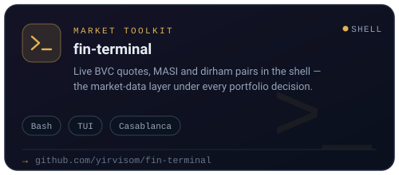
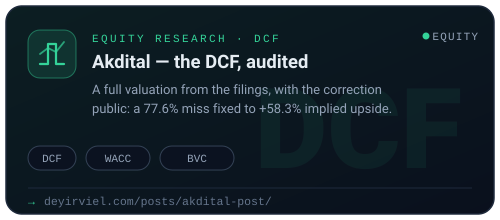
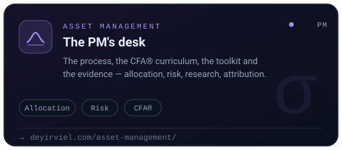
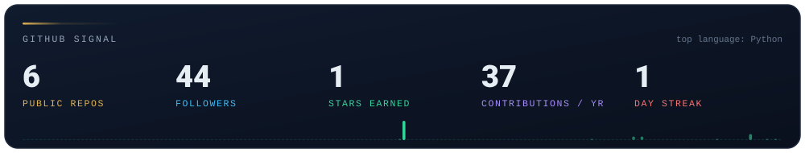
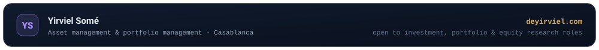

  

  <a href="https://deyirviel.com/asset-management/"><b>Asset Management</b></a> &nbsp;·&nbsp;
  <a href="https://deyirviel.com/pitches/"><b>Pitch Desk</b></a> &nbsp;·&nbsp;
  <a href="https://deyirviel.com/">Portfolio</a> &nbsp;·&nbsp;
  <a href="https://www.linkedin.com/in/yirviel-somé">LinkedIn</a> &nbsp;·&nbsp;
  <a href="mailto:yirviell.some@gmail.com">Email</a>

  
  &nbsp;
  
  &nbsp;
  

### `~/ $ mandate`

I am training to manage capital the way a portfolio manager is accountable for it:
**an explicit objective, a policy allocation, a risk budget, a repeatable research
process, and an attribution report that tells the truth.**

My public work is the evidence trail: portfolio construction and VaR on the Bourse de
Casablanca, a live market-data terminal, full equity valuations rebuilt from the
filings, and a daily stock-pitch discipline. **FMVA® · BIDA® · CFA® track (preparing).**

> **Currently** — working through the CFA® curriculum domain by domain, running factor
> and risk research on Moroccan listed equities, and keeping a daily pitch desk on the
> record.
>
> **Looking for** — asset management, portfolio analyst, investment analyst, equity
> research, or risk analyst roles.

## The process I train on

<table>
  <tr>
    <td width="20%" valign="top"><b>01 · Mandate &amp; IPS</b></td>
    <td>Start from the client's objective, constraints, horizon, liquidity needs, and
    tolerance for loss — not from a view. The investment policy statement is the contract
    every later decision is judged against.</td>
  </tr>
  <tr>
    <td width="20%" valign="top"><b>02 · Strategic allocation</b></td>
    <td>The policy portfolio sets the beta. Equities, fixed income, cash, and alternatives
    sized by horizon, liquidity, and drawdown tolerance — the largest driver of long-run
    outcomes, and the easiest place to fool yourself.</td>
  </tr>
  <tr>
    <td width="20%" valign="top"><b>03 · Security selection</b></td>
    <td>Bottom-up valuation inside the policy bands: DCF, comparables, fundamental screens,
    and factor exposures. A thesis has to survive the filings before it earns a position —
    and a margin of safety before it earns size.</td>
  </tr>
  <tr>
    <td width="20%" valign="top"><b>04 · Construction &amp; risk</b></td>
    <td>Covariance, position limits, concentration rules, factor exposures, VaR and CVaR,
    and stress tests. Risk is sized before the return case is made: the first question is
    what breaks the book, not what beats the benchmark.</td>
  </tr>
  <tr>
    <td width="20%" valign="top"><b>05 · Monitoring &amp; attribution</b></td>
    <td>Performance against the policy benchmark, Brinson and factor attribution,
    rebalancing discipline, and written reporting. The record is the product: returns are
    explained, not merely reported.</td>
  </tr>
</table>

> The desk is the process, not the view.

## The CFA® Program, mapped to the desk

I am preparing for the CFA® Program — **not yet registered** — and reading each domain as
a desk responsibility rather than a checkbox. Ten domains, one integrated job: steward
capital with a process that can be explained.

<table>
  <tr>
    <td width="50%" valign="top">
      <b>Ethics &amp; Professional Standards</b> 
      Trust is the license to manage money. Conflicts, disclosure, fiduciary duty.
    </td>
    <td width="50%" valign="top">
      <b>Quantitative Methods</b> 
      Return distributions, regression, simulation — the math behind the risk numbers.
    </td>
  </tr>
  <tr>
    <td width="50%" valign="top">
      <b>Economics</b> 
      Rates, inflation, and cycles: the macro backdrop every allocation sits inside.
    </td>
    <td width="50%" valign="top">
      <b>Financial Statement Analysis</b> 
      Rebuild the statements before believing the multiple.
    </td>
  </tr>
  <tr>
    <td width="50%" valign="top">
      <b>Corporate Issuers</b> 
      Capital structure, governance, and capital allocation — the quality of the compounding.
    </td>
    <td width="50%" valign="top">
      <b>Equity Investments</b> 
      Valuation, industry structure, and market efficiency inside the policy bands.
    </td>
  </tr>
  <tr>
    <td width="50%" valign="top">
      <b>Fixed Income</b> 
      Duration, credit, and curve positioning — the ballast in a policy portfolio.
    </td>
    <td width="50%" valign="top">
      <b>Derivatives</b> 
      Hedges, exposures, and the real cost of insurance.
    </td>
  </tr>
  <tr>
    <td width="50%" valign="top">
      <b>Alternative Investments</b> 
      Private markets, real assets, and the liquidity premium that pays for patience.
    </td>
    <td width="50%" valign="top">
      <b>Portfolio Management &amp; Wealth Planning</b> 
      The integrating domain: IPS, allocation, risk, attribution, and behavior.
    </td>
  </tr>
</table>

## Selected work

<table>
  <tr>
    <td width="50%">
      
    </td>
    <td width="50%">
      
    </td>
  </tr>
  <tr>
    <td width="50%">
      
    </td>
    <td width="50%">
      
    </td>
  </tr>
</table>

  <b>Daily discipline</b> — <a href="https://deyirviel.com/pitches/">a dated BUY or SELL on a Bourse de Casablanca name, every trading day</a>.

## By the numbers

  

## Toolkit

**Allocation &amp; risk**

     

**Research &amp; valuation**

    

**Engineering &amp; publishing**

     

## The reading room

The shelf behind the process — theory, risk, and the judgment that keeps a portfolio manager honest.

- **Asset Management** — Andrew Ang
- **Active Portfolio Management** — Grinold &amp; Kahn
- **Expected Returns** — Antti Ilmanen
- **Portfolio Selection** — Harry Markowitz
- **Value at Risk** — Philippe Jorion
- **Investments** — Elton, Gruber, Brown &amp; Goetzmann

> **Reading now** — *Asset Management* (Ang) for factor investing, alongside
> *Expected Returns* (Ilmanen)'s risk-premium maps.

## How I work

<table>
  <tr>
    <td width="50%" valign="top">
      <b>Risk first, return second</b> 
      Every position starts with what hurts me. If the drawdown story holds, the
      upside takes care of itself.
    </td>
    <td width="50%" valign="top">
      <b>Process over prediction</b> 
      I don't bet on being right — I bet on being able to explain, test, and size a
      view. Faith in process, not forecasts.
    </td>
  </tr>
  <tr>
    <td width="50%" valign="top">
      <b>The write-up is part of the decision</b> 
      If it cannot be put in front of an investment committee — sourced, sized, and
      falsifiable — it is not a decision yet.
    </td>
    <td width="50%" valign="top">
      <b>Reproducible research</b> 
      Pipelines over one-off spreadsheets — versioned, schedulable, and honest about
      their confidence. No black boxes in finance.
    </td>
  </tr>
</table>

## Elsewhere

- **Asset management &amp; PM** — [deyirviel.com/asset-management](https://deyirviel.com/asset-management/)
- **Stock pitch desk** — [deyirviel.com/pitches](https://deyirviel.com/pitches/)
- **Portfolio &amp; case studies** — [deyirviel.com](https://deyirviel.com)
- **LinkedIn** — [in/yirviel-somé](https://www.linkedin.com/in/yirviel-somé)
- **Email** — [yirviell.some@gmail.com](mailto:yirviell.some@gmail.com)

 

  

